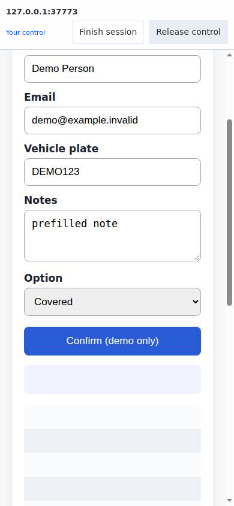
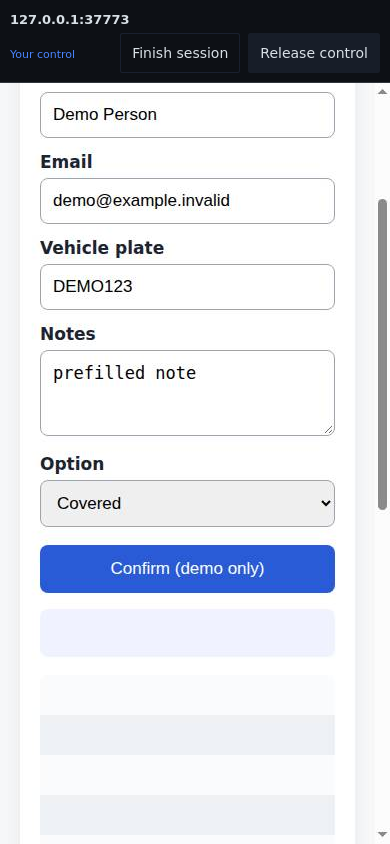

# Hermes Browser Handover

Hand the agent's prepared browser page to your phone, finish the task yourself,
then hand it back. The page stays in the same server browser session.

**0.2.5 community preview.** Independently maintained, not an official Nous Research
plugin or an approved Hermes catalogue entry. Tested with Hermes **v0.22.2** on Linux; other host platforms are unverified.

## How it works

1. Ask Hermes to prepare a page using its local browser tools.
2. Hermes calls `homelab_browser_handover(page_origin, purpose[, browser_session, target_id])`.
3. Open the private link on your phone with Tailscale connected. Tap **Take control**.
4. Scroll, type and complete the task. **Release control** returns the browser to Hermes.
5. The same link allows **Take control again**. Two-tap **Finish session** ends it.

The second tool, `homelab_browser_handover_status(handover_id[, cancel])`, reports
control, completed cycles and whether the agent may continue. Status must be
rechecked immediately before each browser step. Named `browser_exec` sessions must
supply their exact `browser_session`; a name alone cannot access another task's page.

## Install

See the complete [installation and recovery guide](docs/installation.md).

```sh
hermes plugins install thebrownproject/hermes-browser-handover --no-enable
hermes plugins doctor ~/.hermes/plugins/homelab-browser-handover --ci
hermes plugins validate ~/.hermes/plugins/homelab-browser-handover --install-deps
```

For a reproducible install, use `--ref` with the full 40-character commit from the
release instead of following the repository's default branch. Read validation
warnings, configure an owner-authenticated Tailscale Serve route, then enable only
after the harmless demo works. Installing the plugin does not deploy networking.

Requires Python compatible with your Hermes installation, local Chromium browser
tools, Hermes's Bot Desktop lease and an HTTPS Tailscale Serve route. The listener
binds loopback only. **Do not expose it publicly or use Tailscale Funnel.**

## Security and compatibility disclosures

- The viewer controls a logged-in browser. Treat its host and all local processes
  that can access its loopback port as trusted. Serve supplies the exact owner
  identity; a private URL alone is insufficient. Tailnet/device access matters.
- Human takeover uses Hermes's native lease. Lost connections, expired viewer
  authentication and restarts do not silently resume the agent. Only explicit
  handback releases human control. Integrations using direct CDP must honour the
  same lease; unrelated third-party tools are not automatically fenced by this plugin.
- It registers tools and prompt guidance through the public plugin API, but its
  browser binding and control-lease adapters use **undocumented Hermes internals**.
  Validation warns about those imports. No core functions are patched or replaced.
  Retest after every Hermes update. Other Hermes versions are not established.
- It reads protected viewer metadata outside the repository, current-profile
  browser/session registries and lease state. It persists handover metadata under
  the active Hermes home. It does not open credential stores, wallet files or
  browser cookie databases, and stores no typed values or streamed frames.
- The first tool call starts a background loopback HTTP/WebSocket service. It
  connects to the existing local browser's CDP endpoint. There is no telemetry,
  external relay or self-updater. The optional demo starts its own temporary
  Chromium process. Tailscale/SSH setup is outside the plugin.
- Exactly one matching prepared page is required unless an exact eligible target
  is supplied. Replaced, remote/cloud or unverified browser provenance refuses.
  Take control foregrounds only the bound page after acquiring the native lease.
- Popups are announced but not followed. Flows opening a separate bank tab are
  unsupported. This streams a remote browser; it does not transfer cookies to
  Safari, enable native Apple Pay, or provide a payment processor.
- No card filling, payment submission or verification-code service is bundled.
  Those are separate integrations. No successful real payment is claimed.

Read [SECURITY.md](SECURITY.md) before using personal accounts.

## Appearance and acceptance

The compact viewer follows the installed Hermes default Nous theme's colour
mixing and button styles in light/dark mode. Larger phone touch targets and visible
keyboard focus are intentional accessibility differences. A user's custom Hermes
skin is not automatically shared with the viewer. Browsers without CSS `color-mix()`
use the raw palette fallback rather than the exact mixed surface colours.

The owner reports improved real iPhone scrolling on 0.2.4. Automated Chrome/WebKit
checks cover gestures, nested scrolling and repeat control; this is not a claim
that every iPhone, merchant or authentication flow has been tested.

## Screenshots

Synthetic local demo, showing the plugin toolbar in light and dark mode.
The streamed website retains its own styling. No real account or checkout data.

 

## Development

Python3.12 is the core/CI test baseline; native adapters also run under Hermes's
managed Python3.14. Runtime dependency: `websockets>=13,<16`.

```sh
python3 -m venv .venv
.venv/bin/pip install -r requirements-dev.txt
export HBH_CHROME=/path/to/chrome
cd tests
../.venv/bin/python -W ignore -m unittest test_units test_viewer test_browser_ui test_regressions -v
```

The 65 core tests cover authentication, CSRF/tickets, exact target binding,
ownership/expiry, reconnect/restart, persistence failures, actual viewer input,
background-page and nested-panel scrolling, viewport restoration, repeated control
and Finish. Synthetic profiles only. Phone and target use separate browser
processes. Run the [native compatibility smoke](docs/installation.md) separately.

CI also runs WebKit light/dark acceptance with pinned playwright-core1.60.0.
For a local optional run, install it and its WebKit browser, set `PLAYWRIGHT_CORE`
to the package directory and run `python -m unittest test_webkit_ui` from tests.
`HBH_SCREENSHOT_DIR` optionally saves synthetic images outside the source tree.
The WebKit fixture uses synthetic DOM touch events and a loopback identity proxy;
it does not establish physical-device or production identity acceptance by itself.

A [synthetic demo](docs/installation.md) uses a separate temporary browser and
lease. Never point acceptance tests at a real merchant, account or live profile.

## Attribution and catalogue status

MIT licensed. Browser streaming/input techniques adapted from T3 Code retain its
MIT licence. Theme rules adapted from Hermes retain Nous Research's MIT licence.
See [third-party notices](third_party/NOTICE.md). No external fonts/assets are bundled.

Public source publication and [Hermes catalogue admission](docs/catalog-submission.md)
are separate. This community preview is not catalogue-approved or security-audited.
